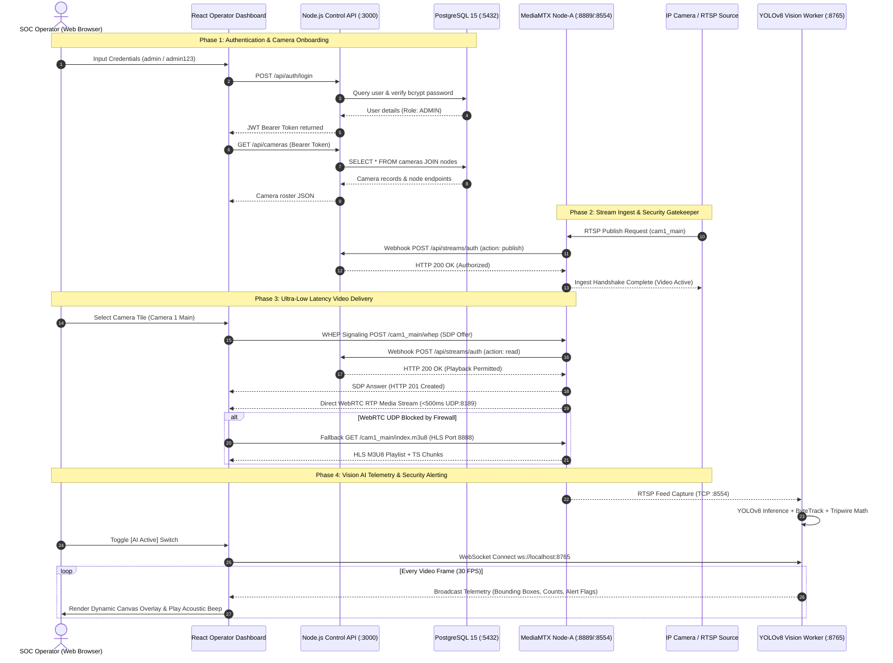

# Telekom Malaysia (TM) • VizAI Media Engine
## System Handover & Operational Deployment Documentation

**Project Name:** VizAI Media Engine (Web-Native Video Management System)  
**Organization:** Telekom Malaysia (TM) Research & Development / Video Management Systems (VMS)  
**Author:** Internship Engineering Team  
**Date:** October 2026  
**Document Version:** 1.0.0  
**Classification:** Internal Handover / Technical Operations  

---

### Document Version History

| Rev | Date | Author / Contributor | Description of Changes | Approved By |
| :--- | :--- | :--- | :--- | :--- |
| **0.1** | 20/09/2026 | Internship Engineering Team | Initial prototype architecture notes and milestone tracking. | Supervisor |
| **0.5** | 02/10/2026 | Internship Engineering Team | Dual-node MediaMTX cluster, PostgreSQL schema, and Express API added. | Supervisor |
| **0.8** | 08/10/2026 | Internship Engineering Team | Added YOLOv8 Vision Worker, WebSocket telemetry, and RBAC authentication. | Supervisor |
| **1.0** | 12/10/2026 | Internship Engineering Team | **Final Project Handover Documentation**: Standardized to TM handover format (Motorola reference), comprehensive step-by-step installation guides with explicit screenshot placeholders, architecture and data-flow diagrams, backup/restoration, and operational maintenance manuals. | Project SV |

---

## Contents

- [1. System Overview](#1-system-overview)
  - [1.1 Project Background & Objectives](#11-project-background--objectives)
  - [1.2 Overall System Architecture](#12-overall-system-architecture)
  - [1.3 End-to-End Data Flow Architecture](#13-end-to-end-data-flow-architecture)
  - [1.4 Technology Stack & Software Versions](#14-technology-stack--software-versions)
- [2. Hardware, VM & Infrastructure Requirements](#2-hardware-vm--infrastructure-requirements)
  - [2.1 Sizing & Resource Allocation Matrix](#21-sizing--resource-allocation-matrix)
  - [2.2 Network Port & Protocol Allocation Matrix](#22-network-port--protocol-allocation-matrix)
  - [2.3 Software & Tool Prerequisites](#23-software--tool-prerequisites)
- [3. Step-by-Step Installation & Setup Guide](#3-step-by-step-installation--setup-guide)
  - [3.1 Step 1: Repository Clone & Workspace Setup](#31-step-1-repository-clone--workspace-setup)
  - [3.2 Step 2: Environment Variable Configuration](#32-step-2-environment-variable-configuration)
  - [3.3 Step 3: Infrastructure Deployment via Docker Compose](#33-step-3-infrastructure-deployment-via-docker-compose)
  - [3.4 Step 4: Database Verification & Schema Initialization](#34-step-4-database-verification--schema-initialization)
  - [3.5 Step 5: Backend API (Control Plane) Installation & Startup](#35-step-5-backend-api-control-plane-installation--startup)
  - [3.6 Step 6: Frontend Operator Dashboard Installation & Startup](#36-step-6-frontend-operator-dashboard-installation--startup)
  - [3.7 Step 7: Vision AI Telemetry Worker Setup (YOLOv8)](#37-step-7-vision-ai-telemetry-worker-setup-yolov8)
  - [3.8 Step 8: Connecting Physical IP Cameras / NVR Channels](#38-step-8-connecting-physical-ip-cameras--nvr-channels)
- [4. Service Verification & Testing Checklist](#4-service-verification--testing-checklist)
  - [4.1 Service Health Verification Matrix](#41-service-health-verification-matrix)
  - [4.2 WebRTC Low-Latency (<500ms) Playback Verification](#42-webrtc-low-latency-500ms-playback-verification)
  - [4.3 HLS Failover Playback Verification](#43-hls-failover-playback-verification)
  - [4.4 Vision AI Telemetry & Tripwire Verification](#44-vision-ai-telemetry--tripwire-verification)
  - [4.5 Snapshot & Security Watermark Verification](#45-snapshot--security-watermark-verification)
- [5. System Administration & Server Operations](#5-system-administration--server-operations)
  - [5.1 Day-to-Day Process & Container Management](#51-day-to-day-process--container-management)
  - [5.2 Container & Process Log Inspection](#52-container-process-log-inspection)
  - [5.3 Production VPC & Nginx Reverse Proxy Deployment](#53-production-vpc--nginx-reverse-proxy-deployment)
  - [5.4 WebRTC NAT Traversal Configuration (`webrtcAdditionalHosts`)](#54-webrtc-nat-traversal-configuration-webrtcadditionalhosts)
- [6. Database Backup & Disaster Recovery Procedures](#6-database-backup--disaster-recovery-procedures)
  - [6.1 Database Backup Procedure (`pg_dump`)](#61-database-backup-procedure-pg_dump)
  - [6.2 Database Restoration Procedure (`pg_restore`)](#62-database-restoration-procedure-pg_restore)
  - [6.3 Disaster Recovery Verification Checklist](#63-disaster-recovery-verification-checklist)
- [7. Core API & Security Specification](#7-core-api--security-specification)
  - [7.1 Authentication & Role-Based Access Control (RBAC)](#71-authentication--role-based-access-control-rbac)
  - [7.2 MediaMTX HTTP Gatekeeper Webhook](#72-mediamtx-http-gatekeeper-webhook)
  - [7.3 REST API Endpoints Specification](#73-rest-api-endpoints-specification)
  - [7.4 Vision Worker WebSocket Telemetry Schema](#74-vision-worker-websocket-telemetry-schema)
- [8. Preventive Maintenance & Housekeeping](#8-preventive-maintenance--housekeeping)
  - [8.1 Docker Volume & Storage Cleanup](#81-docker-volume--storage-cleanup)
  - [8.2 Database Optimization & Index Rebuilding](#82-database-optimization--index-rebuilding)
  - [8.3 Security Updates & Dependency Audits](#83-security-updates--dependency-audits)
- [9. Troubleshooting & Operational FAQs](#9-troubleshooting--operational-faqs)

---

## 1. System Overview

### 1.1 Project Background & Objectives

The **VizAI Media Engine** is a high-performance, web-native Video Management System (VMS) engineered for **Telekom Malaysia (TM)**. The system bridges physical enterprise IP cameras, Network Video Recorders (NVRs), and video analytics with modern browser-based Security Operations Center (SOC) dashboards.

Traditional enterprise VMS solutions suffer from severe drawbacks:
1. **High Ingest Latency:** Standard HLS/DASH pipelines introduce 3 to 10 seconds of delay, making real-time perimeter protection and physical incident response impossible.
2. **Heavy Server Transcoding Overhead:** Most commercial solutions decode and re-encode incoming RTSP feeds on centralized servers, wasting substantial GPU/CPU resources.
3. **Proprietary Plugins & Thick Clients:** Legacy VMS interfaces require ActiveX controls, NPAPI plugins, or dedicated Windows client software, preventing browser-based cross-platform access.
4. **Single-Node Bottlenecks:** Central media hubs often crash or throttle when distributing multi-camera video walls to concurrent operators.

The VizAI Media Engine resolves these challenges by providing:
* **Sub-Second Latency (<500ms):** Direct browser video streaming powered by WebRTC (WHEP — WebRTC HTTP Egress Protocol).
* **Zero-Transcoding Pass-Through:** Ingests H.264 streams from IP cameras and repacketizes them into WebRTC RTP packets on the fly without CPU-heavy re-encoding.
* **Resilient Dual-Node Cluster:** Multi-node edge routing (Node-A Cyberjaya and Node-B Puchong) distributing streaming traffic across nodes.
* **Automated Dual-Protocol Fallback:** Instant failover to HTTP Live Streaming (HLS) if operator corporate firewalls block UDP/WebRTC traffic.
* **Edge Vision AI Analytics:** Decoupled YOLOv8 neural network workers delivering real-time bounding box tracking, ROI intrusion zones, and directional tripwire events directly over WebSockets to client HTML5 canvas overlays.

---

### 1.2 Overall System Architecture

The following diagram illustrates the overall system architecture, network boundaries, and component interactions across the physical edge, media pipeline, central storage/control plane, and consumer operator applications.

```mermaid
flowchart TD
    subgraph LayerEdge["1. Physical Edge & Ingest Simulation Layer"]
        CAM1["Physical IP Camera 01<br/>(Hikvision / Dahua RTSP)"]
        CAM2["Physical IP Camera 02<br/>(Hikvision / Dahua RTSP)"]
        FFMPEG_A["FFmpeg Synthetic Ingest A<br/>(cam1_main • 1280x720 @ 30fps)"]
        FFMPEG_B["FFmpeg Synthetic Ingest B<br/>(cam2_main • 1280x720 @ 30fps)"]
    end

    subgraph LayerCluster["2. Media Pipeline Cluster (Docker Multi-Container)"]
        subgraph NodeA["Streaming Node-A (mediamtx-pbt-a)"]
            RTSP_A["RTSP Ingest<br/>TCP Port 8554"]
            WHEP_A["WebRTC WHEP Signaling<br/>HTTP Port 8889<br/>RTP UDP Port 8189"]
            HLS_A["HLS Engine<br/>HTTP Port 8888"]
            API_A["Control API<br/>TCP Port 9997"]
        end

        subgraph NodeB["Streaming Node-B (mediamtx-pbt-b)"]
            RTSP_B["RTSP Ingest<br/>TCP Port 8555"]
            WHEP_B["WebRTC WHEP Signaling<br/>HTTP Port 8890<br/>RTP UDP Port 8190"]
            HLS_B["HLS Engine<br/>HTTP Port 8887"]
            API_B["Control API<br/>TCP Port 9996"]
        end
    end

    subgraph LayerControl["3. Storage, Control Plane & AI Workers"]
        DB[("PostgreSQL 15 Database<br/>vizai_camera_db<br/>TCP Port 5432")]
        API["Node.js / Express Control API<br/>JWT Auth & MediaMTX Sync<br/>HTTP Port 3000"]
        AI["Python Vision Worker (YOLOv8)<br/>ByteTrack & Perimeter Tripwire<br/>WS Port 8765"]
    end

    subgraph LayerConsumer["4. Consumer Presentation Layer (Web Browser)"]
        UI["React 18 + Tailwind Operator Video Wall<br/>Vite Port 5173 / Production Port 80"]
        CANVAS["Real-Time AI Canvas Overlay<br/>(Bounding Boxes, Intrusion Alerts)"]
    end

    %% Ingest Flows
    CAM1 -.->|RTSP Stream| RTSP_A
    CAM2 -.->|RTSP Stream| RTSP_B
    FFMPEG_A -->|RTSP Push| RTSP_A
    FFMPEG_B -->|RTSP Push| RTSP_B

    %% Control Plane Integration
    API <-->|SQL Queries / Connection Pool| DB
    API -->|Dynamic Path Creation / Health Polling| API_A
    API -->|Dynamic Path Creation / Health Polling| API_B
    NodeA -->|Auth Webhook /api/streams/auth| API
    NodeB -->|Auth Webhook /api/streams/auth| API

    %% AI Pipeline
    RTSP_A -.->|OpenCV Video Capture| AI
    AI -->|WebSocket Telemetry JSON| CANVAS

    %% Client Consumption
    UI <-->|REST API / JWT Session| API
    WHEP_A -->|WebRTC Media (<500ms Primary)| UI
    HLS_A -->|HLS TS Segments (Fallback)| UI
    WHEP_B -->|WebRTC Media (<500ms Primary)| UI
    HLS_B -->|HLS TS Segments (Fallback)| UI
    UI --- CANVAS
```

---

### 1.3 End-to-End Data Flow Architecture

The data flow spans stream publishing, authentication verification, playback negotiation, and vision telemetry distribution:



---

### 1.4 Technology Stack & Software Versions

The technology stack is purposefully chosen for zero-dependency portability, sub-second latency, and horizontal scalability:

| Tier | Component / Software | Tested Version | License | Operational Role |
| :--- | :--- | :--- | :--- | :--- |
| **Media Server Cluster** | [MediaMTX (Bluenviron)](https://github.com/bluenviron/mediamtx) | `v1.9.0` (Latest Docker) | MIT | Zero-transcoding RTSP-to-WebRTC (WHEP) and HLS media gateway. |
| **Ingest Simulation** | FFmpeg Alpine | `4.4-alpine` | LGPL / GPL | Generates 24/7 test pattern streams (`lavfi testsrc`) with zero latency flags. |
| **Database Engine** | PostgreSQL | `15.0-alpine` | PostgreSQL License | Relational storage for nodes, cameras, users, and stream health logs. |
| **Backend Runtime** | Node.js | `v20.18.0` (LTS) | MIT | High-concurrency event-driven JavaScript server runtime. |
| **Backend Framework** | Express.js | `^4.19.2` | MIT | REST API control plane, authentication, and MediaMTX webhooks. |
| **Backend Language** | TypeScript | `^5.4.5` | Apache 2.0 | Type-safe backend logic and database abstraction. |
| **Frontend Framework** | React + Vite | `React 18.3` / `Vite 5` | MIT | Single-page operator application with Instant Hot-Module Reloading. |
| **Styling & Design** | Tailwind CSS | `^3.4.1` | MIT | Corporate Telekom Malaysia UI theme (`#FF5100` TM Orange, `#0B132B` Deep Slate). |
| **Video Playback** | Native WHEP + `hls.js` | `hls.js ^1.5.8` | Apache 2.0 | Dual-protocol video rendering engine with sub-second WebRTC and resilient HLS fallback. |
| **AI Vision Engine** | Ultralytics YOLOv8 | `8.2.0` | AGPL-3.0 | Real-time object tracking, person detection, and ByteTrack spatial analytics. |
| **Computer Vision** | OpenCV Python | `opencv-python 4.9.0` | Apache 2.0 | Hardware-accelerated RTSP frame capture and zero-latency buffer extraction. |
| **Container Engine** | Docker & Docker Compose | `Docker 24+ / Compose v2` | Apache 2.0 | Reproducible container orchestration for databases and streaming nodes. |

---

## 2. Hardware, VM & Infrastructure Requirements

### 2.1 Sizing & Resource Allocation Matrix

Depending on whether the deployment is a **single-machine local prototype**, an **on-premises VMware ESXi virtual cluster**, or a **cloud VPC deployment**, allocate resources based on the following hardware sizing specification:

| Node / Role | Hostname / Service | CPU Cores | Memory (RAM) | Storage (SSD) | OS / Runtime | Recommended Purpose |
| :--- | :--- | :--- | :--- | :--- | :--- | :--- |
| **Database Server** | `vizai-postgres` | 2 vCPU | 4 GB | 50 GB | Alpine / Ubuntu 22.04 | PostgreSQL 15 database instance and volume storage. |
| **Streaming Node-A** | `mediamtx-pbt-a` | 4 vCPU | 8 GB | 100 GB | Ubuntu 22.04 (Docker) | Primary Cyberjaya ingest node (50 concurrent WebRTC streams). |
| **Streaming Node-B** | `mediamtx-pbt-b` | 4 vCPU | 8 GB | 100 GB | Ubuntu 22.04 (Docker) | Secondary Puchong ingest node (50 concurrent WebRTC streams). |
| **Control Plane API** | `vizai-core-api` | 2 vCPU | 4 GB | 30 GB | Ubuntu 22.04 / Node 20 | Express REST API server, auth webhook handler, health polling. |
| **Web Operator UI** | `vizai-dashboard` | 1 vCPU | 2 GB | 20 GB | Nginx Web Server | Static Vite production build bundle serving the video wall. |
| **Vision AI Worker** | `vizai-ai-worker` | 4 vCPU / 1 GPU | 8 GB (16 GB if GPU) | 100 GB | Ubuntu 22.04 / PyTorch | YOLOv8 inference (Nvidia T4, RTX 3060+, or 4-core AVX2 CPU). |
| **Combined Dev Node** | *All-in-One PC* | 6–8 Cores | 16 GB | 120 GB SSD | Windows 11 / Ubuntu | Recommended workstation for single-machine local test and dev. |

---

### 2.2 Network Port & Protocol Allocation Matrix

Ensure firewall policies (AWS Security Groups, ESXi vSwitch firewalls, or Linux `ufw`) permit traffic across the following ports:

| Port | Protocol | Host Container / Service | Traffic Direction | Description & Operational Function |
| :--- | :--- | :--- | :--- | :--- |
| **5432** | TCP | `vizai-postgres` | Inbound / Internal | PostgreSQL database communication with API server. |
| **8554** | TCP | `mediamtx-pbt-a` | Inbound | Node-A RTSP ingest port (Cameras/FFmpeg publish feeds here). |
| **8555** | TCP | `mediamtx-pbt-b` | Inbound | Node-B RTSP ingest port (Cameras/FFmpeg publish feeds here). |
| **8889** | TCP / HTTP | `mediamtx-pbt-a` | Inbound | Node-A WebRTC WHEP signaling endpoint. |
| **8890** | TCP / HTTP | `mediamtx-pbt-b` | Inbound | Node-B WebRTC WHEP signaling endpoint. |
| **8189** | UDP | `mediamtx-pbt-a` | Inbound / Outbound | Node-A WebRTC RTP media packet delivery to browser clients. |
| **8190** | UDP | `mediamtx-pbt-b` | Inbound / Outbound | Node-B WebRTC RTP media packet delivery to browser clients. |
| **8888** | TCP / HTTP | `mediamtx-pbt-a` | Inbound | Node-A HLS master playlist and transport stream chunk delivery. |
| **8887** | TCP / HTTP | `mediamtx-pbt-b` | Inbound | Node-B HLS master playlist and transport stream chunk delivery. |
| **9997** | TCP / HTTP | `mediamtx-pbt-a` | Internal VPC | Node-A MediaMTX REST Management Control API. |
| **9996** | TCP / HTTP | `mediamtx-pbt-b` | Internal VPC | Node-B MediaMTX REST Management Control API (mapped to container 9997). |
| **3000** | TCP / HTTP | `server (Node.js)` | Inbound | VizAI Core Control Plane REST API and MediaMTX webhook. |
| **5173** | TCP / HTTP | `client (Vite)` | Inbound | Vite development server for the React operator dashboard. |
| **8765** | TCP / WS | `vision-worker` | Inbound | Python WebSocket telemetry server broadcasting AI detections. |

---

### 2.3 Software & Tool Prerequisites

Before proceeding with installation, ensure the following tools are installed on the deployment machine:

1. **Operating System:** Ubuntu Linux 22.04 LTS (recommended for server) or Windows 10/11 64-bit with PowerShell 7+.
2. **Docker Engine & Docker Compose:** Docker version `24.0.0+` and Docker Compose v2 (`docker compose version`).
3. **Node.js Runtime:** Node.js version `20.x` or `22.x LTS` and npm version `10.x+`.
4. **Python Environment (for AI Module):** Python `3.10` or higher with `pip` and virtual environment support (`python -m venv`).
5. **Git Version Control:** Git `2.40+`.
6. **Web Browser:** Google Chrome, Microsoft Edge, or Chromium browser (v115+) with WebSockets and WebRTC hardware acceleration enabled.

Verify installed prerequisite versions via terminal:

```bash
# On Linux / macOS:
git --version
docker --version
docker compose version
node --version
npm --version
python3 --version

# On Windows (PowerShell):
git --version
docker --version
docker compose version
node --version
npm --version
py --version
```

---

## 3. Step-by-Step Installation & Setup Guide

This section outlines the exact sequence of steps required to set up, configure, and boot the entire VizAI Media Engine from scratch. Explicit screenshot placeholders indicate the exact evidence to capture for handover audit reports.

---

### 3.1 Step 1: Repository Clone & Workspace Setup

1. Open your terminal or PowerShell console.
2. Clone the repository from the internal Telekom Malaysia source code repository:
   ```bash
   git clone <REPOSITORY_URL>
   cd vizai-media-engine
   ```
3. Inspect the repository structure to verify all core directories and configuration files exist:
   ```bash
   # Linux / macOS
   ls -la

   # Windows PowerShell
   Get-ChildItem
   ```

> 📸 **[Screenshot Placeholder 1: Repository Root Directory Structure]**  
> *Capture your terminal window displaying the output of `ls -la` or `Get-ChildItem`. The screenshot must clearly show `docker-compose.yml`, `init.sql`, `mediamtx-a.yml`, `mediamtx-b.yml`, `server/`, `client/`, `vision-worker/`, and `yolov8n.pt`.*

---

### 3.2 Step 2: Environment Variable Configuration

The Control Plane API and MediaMTX nodes require environment variables and networking parameters configured before boot.

1. Navigate to the `server/` directory:
   ```bash
   cd server
   ```
2. Create the production `.env` configuration file from the template:
   ```bash
   # Linux / macOS
   cp .env.example .env

   # Windows PowerShell
   Copy-Item .env.example .env
   ```
3. Open `server/.env` in your text editor (e.g. `nano .env` or `notepad .env`) and review the parameters:
   ```ini
   # Server Port
   PORT=3000

   # Central PostgreSQL Connection Settings
   DB_HOST=localhost
   DB_PORT=5432
   DB_USER=vizai_admin
   DB_PASSWORD=vizai_password
   DB_NAME=vizai_camera_db

   # JWT Security Secret for Operator Token Signing
   JWT_SECRET=super_secret_jwt_key_tm_vms_production_2026

   # Stream Access Token Strictness (false = permissive dev; true = strict production)
   STREAM_SECURITY_STRICT=false
   ```
   *(Note: For production or shared deployments, generate a unique `JWT_SECRET` and update `DB_PASSWORD` to a secure string.)*

4. Return to the repository root directory:
   ```bash
   cd ..
   ```

5. **Verify MediaMTX Configurations:**  
   Open `mediamtx-a.yml` and `mediamtx-b.yml`. Note the `webrtcAdditionalHosts` setting:
   ```yaml
   webrtcAdditionalHosts:
     - 127.0.0.1
   ```
   *(Note: For local testing, `127.0.0.1` is optimal. If deploying to a server or VPC VM, replace `127.0.0.1` with the server's LAN IP or Elastic Public IP).*

> 📸 **[Screenshot Placeholder 2: Environment Configuration File (`server/.env`)]**  
> *Capture a screenshot of your text editor or terminal displaying `server/.env` with the database credentials and JWT parameters clearly configured.*

---

### 3.3 Step 3: Infrastructure Deployment via Docker Compose

The database and streaming cluster are orchestrated via Docker Compose.

1. From the repository root, start the infrastructure containers in detached mode:
   ```bash
   docker compose up -d
   ```
2. Wait 10 seconds for the PostgreSQL container and MediaMTX instances to initialize.
3. Check the status of all containers:
   ```bash
   docker compose ps
   ```
   Expected healthy containers:
   * `vizai-postgres` (Status: Up, Port: 5432)
   * `mediamtx-pbt-a` (Status: Up, Ports: 8554, 8888, 8889, 8189/udp, 9997)
   * `mediamtx-pbt-b` (Status: Up, Ports: 8555, 8887, 8890, 8190/udp, 9996)
   * `stream-generator-a` (Status: Up, FFmpeg Synthetic Feeds)
   * `stream-generator-b` (Status: Up, FFmpeg Synthetic Feeds)

> 📸 **[Screenshot Placeholder 3: Docker Compose Services Running]**  
> *Capture your terminal showing the output of `docker compose ps` with all 5 containers (`vizai-postgres`, `mediamtx-pbt-a`, `mediamtx-pbt-b`, `stream-generator-a`, and `stream-generator-b`) displaying the `Up` status and port bindings.*

---

### 3.4 Step 4: Database Verification & Schema Initialization

PostgreSQL automatically executes `init.sql` upon the initial volume creation.

1. Test database connectivity using the container's native `pg_isready` tool:
   ```bash
   docker exec vizai-postgres pg_isready -U vizai_admin -d vizai_camera_db
   ```
   Expected output:
   ```text
   vizai_camera_db:5432 - accepting connections
   ```

2. Inspect the seeded tables and records using `psql`:
   ```bash
   docker exec -it vizai-postgres psql -U vizai_admin -d vizai_camera_db -c "\dt"
   ```
   Expected tables listed:
   * `nodes`
   * `cameras`
   * `users`

3. Verify default streaming nodes in the database:
   ```bash
   docker exec -it vizai-postgres psql -U vizai_admin -d vizai_camera_db -c "SELECT id, name, host, rtsp_port, webrtc_port, hls_port, api_port FROM nodes;"
   ```

4. Verify default cameras in the database:
   ```bash
   docker exec -it vizai-postgres psql -U vizai_admin -d vizai_camera_db -c "SELECT id, name, stream_key, rtsp_source_url, status FROM cameras;"
   ```

> 📸 **[Screenshot Placeholder 4: PostgreSQL Database Table Verification]**  
> *Capture terminal output showing the output of the SQL query displaying the initialized `nodes` (Node-A, Node-B) and `cameras` (`cam1_main`, `cam2_main`) rows inside PostgreSQL.*

---

### 3.5 Step 5: Backend API (Control Plane) Installation & Startup

The backend is built in TypeScript and runs on Node.js.

1. Open a **new dedicated terminal window** and change directory into `server/`:
   ```bash
   cd server
   ```
2. Install dependencies cleanly using `npm ci`:
   ```bash
   npm ci
   ```
3. Start the API server in development mode:
   ```bash
   npm run dev
   ```
4. Confirm successful boot. The console will output:
   ```text
   [Database] Initialized and verified schema tables successfully.
   [MediaMTX Sync] Synced 2 camera paths with MediaMTX nodes.
   [MediaMTX Health Polling] Active for nodes: Node-A, Node-B
   [VizAI Core API] Running on http://localhost:3000
   ```
5. Leave this terminal open.
6. In another terminal, verify the API health endpoint:
   ```bash
   # Linux / macOS
   curl http://localhost:3000/

   # Windows PowerShell
   Invoke-RestMethod http://localhost:3000/
   ```
   Expected JSON response:
   ```json
   {
     "status": "ONLINE",
     "service": "VizAI Core API Service",
     "timestamp": "2026-10-12T..."
   }
   ```

> 📸 **[Screenshot Placeholder 5: Backend API Console & Health Endpoint]**  
> *Capture a split or combined screenshot showing: (Left) The Node.js terminal running `npm run dev` with successful startup logs; (Right) A browser or curl terminal confirming `http://localhost:3000/` returns `{"status":"ONLINE"}`.*

---

### 3.6 Step 6: Frontend Operator Dashboard Installation & Startup

The operator video wall runs as a React single-page application using Vite.

1. Open a **new dedicated terminal window** and change directory into `client/`:
   ```bash
   cd client
   ```
2. Install frontend dependencies using `npm ci`:
   ```bash
   npm ci
   ```
3. Start the Vite development web server:
   ```bash
   npm run dev
   ```
4. The terminal will display the local development URL:
   ```text
     VITE v5.x.x  ready in 340 ms

     ➜  Local:   http://localhost:5173/
     ➜  Network: use --host to expose
   ```
5. Open your web browser and navigate to `http://localhost:5173`.
6. Log into the system using the default administrative credentials:
   * **Username:** `admin`
   * **Password:** `admin123`
   *(Or standard operator credentials: `operator` / `operator123`)*

> 📸 **[Screenshot Placeholder 6: Operator Dashboard Login Screen]**  
> *Capture the web browser displaying the VizAI Media Engine authentication screen with Telekom Malaysia branding and login dialog.*

> 📸 **[Screenshot Placeholder 7: Operator Video Wall (Live Feeds)]**  
> *Capture the web browser after logging in, showing the multi-channel video wall displaying the live `cam1_main` and `cam2_main` test video feeds with real-time green ONLINE badges, matrix buttons (`1x1`, `2x2`, `3x3`), and stream diagnostics.*

---

### 3.7 Step 7: Vision AI Telemetry Worker Setup (YOLOv8)

The Vision Worker is a decoupled Python service that pulls live video from RTSP, runs YOLOv8 object detection, calculates spatial tripwire crossings, and broadcasts telemetry to the dashboard via WebSockets.

1. Open a **new dedicated terminal window** and change directory into `vision-worker/`:
   ```bash
   cd vision-worker
   ```
2. Create and activate a Python virtual environment:
   ```bash
   # On Linux / macOS:
   python3 -m venv .venv
   source .venv/bin/activate

   # On Windows (PowerShell):
   py -3 -m venv .venv
   .\.venv\Scripts\Activate.ps1
   ```
3. Install required Python packages:
   ```bash
   pip install --upgrade pip
   pip install -r requirements.txt
   ```
4. Verify the YOLO model weights file exists in the repository root (`../yolov8n.pt`).
5. Launch the Vision AI worker, pointing to the Node-A RTSP feed on port 8554:
   ```bash
   # Linux / macOS:
   python vision_worker.py --rtsp "rtsp://localhost:8554/cam1_main" --port 8765 --model ../yolov8n.pt

   # Windows (PowerShell):
   python vision_worker.py --rtsp "rtsp://localhost:8554/cam1_main" --port 8765 --model ..\yolov8n.pt
   ```
   *(Note on Windows: You can also execute the included shortcut batch file `start_worker.bat`)*.
6. The worker will initialize OpenCV, load the YOLOv8 model weights onto your CPU/GPU, and start listening on WebSocket port `8765`:
   ```text
   [INFO] Connecting background RTSP capture to: rtsp://localhost:8554/cam1_main
   [INFO] RTSP stream connected successfully!
   [INFO] WebSocket Telemetry Server started on 0.0.0.0:8765
   ```
7. Open the browser at `http://localhost:5173`. Hover over **Camera 1 Main** and toggle the **AI Active** button.
8. The worker console will immediately output:
   ```text
   [INFO] Client connected to telemetry stream: 127.0.0.1
   ```

> 📸 **[Screenshot Placeholder 8: Vision AI Worker Terminal Output]**  
> *Capture the Python worker terminal output showing successful RTSP stream connection, model initialization, and `Client connected to telemetry stream`.*

> 📸 **[Screenshot Placeholder 9: Live Video Wall with AI Canvas Overlay]**  
> *Capture the browser video wall with the AI overlay enabled, displaying real-time bounding boxes, FPS telemetry counters, ROI Door Intrusion box, and Directional Tripwire count stats.*

---

### 3.8 Step 8: Connecting Physical IP Cameras / NVR Channels

When deploying with physical surveillance hardware (e.g., Hikvision, Dahua, or Uniview NVRs):

1. **Verify Network Connectivity:**  
   Ensure the host machine can ping the IP camera/NVR IP address over the surveillance VLAN or VPN.
2. **Access Camera Registration in Dashboard:**  
   Log in as an Administrator (`admin`), navigate to the **Camera Management** tab, and click **+ Register New Camera**.
3. **Fill Camera Parameters:**  
   * **Camera Name:** `TM Cyberjaya Gate 1`
   * **Stream Key:** `tm_cyb_gate_01` (lowercase alphanumeric slug)
   * **RTSP Source URL:** `rtsp://<CAMERA_USER>:<CAMERA_PASS>@<CAMERA_IP>:554/Streaming/Channels/101`
   * **Target Node:** Select `Node-A (Cyberjaya)` or `Node-B (Puchong)`.
   * **Resolution:** `1920x1080` or `1280x720`.
4. Click **Save & Synchronize**.
5. The API instantly calls the MediaMTX Control API (`POST :9997/v3/config/paths/add/tm_cyb_gate_01`) to begin on-demand RTSP pulling without restarting the server!
6. Open the **Live Monitor** view to confirm video playback.
7. *(Optional for clean production)*: Stop the synthetic test generators in `docker-compose.yml`:
   ```bash
   docker stop stream-generator-a stream-generator-b
   ```

> 📸 **[Screenshot Placeholder 10: Camera Registration Modal in Dashboard]**  
> *Capture the web dashboard modal with camera name, RTSP source URL, and node selector filled out.*

---

## 4. Service Verification & Testing Checklist

### 4.1 Service Health Verification Matrix

Use this checklist during handover validation to verify all services are functioning properly:

| Service Name | Check Command / URL | Expected Output / State | Verified? |
| :--- | :--- | :--- | :--- |
| **PostgreSQL 15** | `docker exec vizai-postgres pg_isready` | `accepting connections` | [ ] Passed |
| **MediaMTX Node-A** | `curl -s http://localhost:9997/v3/paths/list` | JSON listing active paths (`items: [...]`) | [ ] Passed |
| **MediaMTX Node-B** | `curl -s http://localhost:9996/v3/paths/list` | JSON listing active paths (`items: [...]`) | [ ] Passed |
| **Backend REST API** | `curl http://localhost:3000/` | `{"status":"ONLINE", ...}` | [ ] Passed |
| **Camera List Endpoint**| `curl http://localhost:3000/api/cameras` | `{"success":true, "data":[...]}` | [ ] Passed |
| **Frontend Web App** | Browser: `http://localhost:5173` | Login page loads with TM branding | [ ] Passed |
| **YOLOv8 AI Worker** | Browser Console: `ws://localhost:8765` | WebSocket `101 Switching Protocols` | [ ] Passed |

---

### 4.2 WebRTC Low-Latency (<500ms) Playback Verification

1. In the browser dashboard (`http://localhost:5173`), inspect **Camera 1 Main**.
2. Open Chrome Developer Tools (**F12**) -> **Network Tab** -> Filter by `Fetch/XHR`.
3. Verify the WHEP request to `http://localhost:8889/cam1_main/` completes with HTTP `201 Created`.
4. Check the video timestamp against physical real-time or synthetic clock pattern. Delay should remain below **400ms**.

> 📸 **[Screenshot Placeholder 11: Developer Tools Network WHEP Handshake]**  
> *Capture browser developer tools showing the successful HTTP 201 response for the WHEP request alongside the active WebRTC stream player.*

---

### 4.3 HLS Failover Playback Verification

1. On the stream tile, locate the protocol dropdown or switch button.
2. Switch playback from **WebRTC** to **HLS (Backup Stream)**.
3. Verify in Developer Tools that the browser requests:
   `http://localhost:8888/cam1_main/index.m3u8`
4. Confirm HLS video chunks (`.ts` segments) load and play smoothly without interruption.

> 📸 **[Screenshot Placeholder 12: HLS Fallback Stream Playback]**  
> *Capture the browser stream tile displaying the HLS badge and developer tools showing regular `.ts` segment chunk downloads.*

---

### 4.4 Vision AI Telemetry & Tripwire Verification

1. On the stream tile, toggle **AI Active** to ON.
2. In the AI Settings panel:
   * Draw or enable the **ROI Door Intrusion Box**.
   * Draw or enable the **Directional Tripwire**.
3. Have a person walk across the tripwire or simulate motion in front of the camera.
4. Verify that:
   * The bounding box tracks the person with an assigned ID (e.g. `#1 Person 92%`).
   * Crossing the tripwire increments the **IN / OUT Counter**.
   * Entering the ROI door box triggers the red **ALARM: BREACH DETECTED** banner and audible alert.

> 📸 **[Screenshot Placeholder 13: Perimeter Tripwire & Breach Detection Event]**  
> *Capture the video feed showing a detected person crossing the virtual tripwire with the alert banner visible in the operator UI.*

---

### 4.5 Snapshot & Security Watermark Verification

1. Hover over any active camera stream tile and click the **Camera Snapshot** icon.
2. The browser will download an instant JPEG file (e.g., `snapshot_cam1_main_2026-10-12.jpg`).
3. Open the downloaded image file.
4. Verify that the bottom border contains an embedded forensic security watermark containing:
   * Camera Name & Stream Key
   * Server Node Identifier (`Node-A`)
   * Exact Timestamp with Millisecond Precision
   * Telekom Malaysia SOC Authentication Stamp

> 📸 **[Screenshot Placeholder 14: Exported Snapshot with Watermark]**  
> *Capture the exported JPEG image showing the watermark overlay along the bottom of the video frame.*

---

## 5. System Administration & Server Operations

### 5.1 Day-to-Day Process & Container Management

Routine administrative commands executed from the repository root:

```bash
# Check running containers and port mappings
docker compose ps

# Stop all background infrastructure services (preserves database volume)
docker compose stop

# Restart infrastructure services
docker compose start

# Terminate containers (data preserved in Docker volume 'pgdata')
docker compose down

# Rebuild containers from scratch
docker compose up -d --build
```

---

### 5.2 Container & Process Log Inspection

When diagnosing stream failures or ingest issues, inspect logs:

```bash
# View last 100 lines of PostgreSQL logs
docker compose logs --tail 100 postgres-db

# Follow MediaMTX Node-A logs in real-time
docker compose logs -f mediamtx-pbt-a

# Follow MediaMTX Node-B logs in real-time
docker compose logs -f mediamtx-pbt-b

# View synthetic stream generator logs
docker compose logs --tail 50 stream-generator-a
```

---

### 5.3 Production VPC & Nginx Reverse Proxy Deployment

In a hardened enterprise deployment (e.g. TM Cloud or AWS VPC), terminate TLS and route client requests through an Nginx reverse proxy on port 80/443.

Example Nginx server block configuration (`/etc/nginx/sites-available/vizai.conf`):

```nginx
# Upstream Definitions
upstream vizai_api {
    server 127.0.0.1:3000;
}

upstream vizai_node_a_webrtc {
    server 127.0.0.1:8889;
}

upstream vizai_node_a_hls {
    server 127.0.0.1:8888;
}

upstream vizai_ai_worker {
    server 127.0.0.1:8765;
}

server {
    listen 80;
    server_name vms.tmrnd.com.my;
    # Redirect HTTP to HTTPS in production
    return 301 https://$host$request_uri;
}

server {
    listen 443 ssl http2;
    server_name vms.tmrnd.com.my;

    ssl_certificate /etc/ssl/certs/vizai_bundle.crt;
    ssl_certificate_key /etc/ssl/private/vizai.key;

    # 1. Operator Web Dashboard Static Assets
    location / {
        root /var/www/vizai-media-engine/client/dist;
        index index.html;
        try_files $uri $uri/ /index.html;
    }

    # 2. Control Plane REST API
    location /api/ {
        proxy_pass http://vizai_api;
        proxy_http_version 1.1;
        proxy_set_header Host $host;
        proxy_set_header X-Real-IP $remote_addr;
        proxy_set_header X-Forwarded-For $proxy_add_x_forwarded_for;
    }

    # 3. WebRTC WHEP Signaling (Node-A)
    location /node-a/whep/ {
        proxy_pass http://vizai_node_a_webrtc/;
        proxy_http_version 1.1;
        proxy_set_header Host $host;
    }

    # 4. HLS Stream Delivery (Node-A)
    location /node-a/hls/ {
        proxy_pass http://vizai_node_a_hls/;
        proxy_http_version 1.1;
        add_header Access-Control-Allow-Origin *;
    }

    # 5. Vision AI Telemetry WebSocket
    location /ws/telemetry/ {
        proxy_pass http://vizai_ai_worker/;
        proxy_http_version 1.1;
        proxy_set_header Upgrade $http_upgrade;
        proxy_set_header Connection "Upgrade";
        proxy_set_header Host $host;
    }
}
```

---

### 5.4 WebRTC NAT Traversal Configuration (`webrtcAdditionalHosts`)

When deploying behind Network Address Translation (NAT) or a cloud Virtual Private Cloud (VPC), browser WebRTC sessions require public IP advertisement for ICE candidate exchange.

1. Open `mediamtx-a.yml` and `mediamtx-b.yml`.
2. Locate the `webrtcAdditionalHosts` section:
   ```yaml
   webrtcAdditionalHosts:
     - "202.168.10.45"   # Replace with your external VPC Public/Elastic IP
   ```
3. Restart the MediaMTX containers:
   ```bash
   docker compose restart mediamtx-pbt-a mediamtx-pbt-b
   ```
4. Confirm WebRTC UDP ports (`8189` and `8190`) are permitted in the cloud firewall / security group.

---

## 6. Database Backup & Disaster Recovery Procedures

To safeguard camera catalogs, user records, and streaming node metadata, follow these database backup and restoration procedures.

---

### 6.1 Database Backup Procedure (`pg_dump`)

Backups are generated using PostgreSQL's native custom-format binary archiver (`pg_dump -F c`).

1. Define a timestamped backup filename and execute `pg_dump` inside the container:
   ```bash
   # Linux / macOS / Windows PowerShell:
   docker exec vizai-postgres pg_dump -U vizai_admin -F c -d vizai_camera_db -f /tmp/vizai_camera_db_backup.dump
   ```

2. Copy the backup file from the container to a secure local or external backup directory:
   ```bash
   # Copy to current working directory:
   docker cp vizai-postgres:/tmp/vizai_camera_db_backup.dump ./vizai_camera_db_$(date +%Y%m%d).dump

   # On Windows PowerShell:
   $today = Get-Date -Format "yyyyMMdd"
   docker cp vizai-postgres:/tmp/vizai_camera_db_backup.dump .\vizai_camera_db_$today.dump
   ```

3. Remove the temporary dump file inside the container:
   ```bash
   docker exec vizai-postgres rm /tmp/vizai_camera_db_backup.dump
   ```

> 📸 **[Screenshot Placeholder 15: Database Backup Execution]**  
> *Capture terminal output showing the successful execution of `pg_dump` and `docker cp` resulting in the created `.dump` backup file.*

---

### 6.2 Database Restoration Procedure (`pg_restore`)

In the event of database corruption, data loss, or server migration:

1. Ensure the PostgreSQL container is running:
   ```bash
   docker compose up -d postgres-db
   ```

2. Copy your verified backup file into the container:
   ```bash
   docker cp ./vizai_camera_db_YYYYMMDD.dump vizai-postgres:/tmp/restore_target.dump
   ```

3. Restore the schema and data using `pg_restore` with clean flags (`--clean --if-exists` drops existing objects before recreating them):
   ```bash
   docker exec vizai-postgres pg_restore -U vizai_admin -d vizai_camera_db --clean --if-exists /tmp/restore_target.dump
   ```

4. Clean up the temporary restoration file:
   ```bash
   docker exec vizai-postgres rm /tmp/restore_target.dump
   ```

5. Restart the Node.js API server to refresh database connection pools:
   ```bash
   # Restart API server terminal
   npm run dev
   ```

> 📸 **[Screenshot Placeholder 16: Database Restore Execution]**  
> *Capture terminal output showing the `pg_restore` command executing cleanly and returning exit code 0.*

---

### 6.3 Disaster Recovery Verification Checklist

After executing a database restoration, perform this sanity check:

1. **Check Camera Records:**
   ```bash
   docker exec -it vizai-postgres psql -U vizai_admin -d vizai_camera_db -c "SELECT count(*) FROM cameras;"
   ```
2. **Check Streaming Node Records:**
   ```bash
   docker exec -it vizai-postgres psql -U vizai_admin -d vizai_camera_db -c "SELECT name, host, webrtc_port FROM nodes;"
   ```
3. **Check User Logins:**  
   Log into the web dashboard at `http://localhost:5173` using `admin` / `admin123`.

---

## 7. Core API & Security Specification

### 7.1 Authentication & Role-Based Access Control (RBAC)

The system enforces JSON Web Token (JWT) Bearer authentication with two roles:

* **`ADMIN`:** Full administrative access. Can register new cameras, edit camera settings, delete cameras, view node topology, and create/manage staff operator accounts.
* **`OPERATOR`:** Read-only surveillance access. Can view live video streams, toggle AI overlays, switch WebRTC/HLS protocols, and export forensic snapshots. Cannot edit camera routes or access user accounts.

#### Login Authentication Endpoint:
* **Route:** `POST /api/auth/login`
* **Request Body:**
  ```json
  {
    "username": "admin",
    "password": "admin123"
  }
  ```
* **Response (HTTP 200):**
  ```json
  {
    "success": true,
    "token": "eyJhbGciOiJIUzI1NiIsInR5cCI6IkpXVCJ9...",
    "user": {
      "id": "c1f7a63d-4c8a-4db5-9e63-b1d6e0a84e49",
      "username": "admin",
      "full_name": "VMS System Administrator",
      "role": "ADMIN"
    }
  }
  ```

---

### 7.2 MediaMTX HTTP Gatekeeper Webhook

MediaMTX delegates stream publishing and viewing permissions to the Node.js Control Plane via HTTP webhooks configured in `mediamtx-a.yml` and `mediamtx-b.yml`:

* **Webhook Address:** `http://host.docker.internal:3000/api/streams/auth`
* **Request Payload Sent by MediaMTX:**
  ```json
  {
    "action": "read",
    "path": "cam1_main",
    "protocol": "webrtc",
    "ip": "127.0.0.1",
    "query": "token=eyJhbGciOi..."
  }
  ```
* **Authorization Behavior:**
  * If `STREAM_SECURITY_STRICT=false`: Returns HTTP 200 (Permissive development mode).
  * If `STREAM_SECURITY_STRICT=true`: Validates token signature and expiration. Returns HTTP 200 (Allowed) or HTTP 403 (Denied).

---

### 7.3 REST API Endpoints Specification

| Method | Endpoint | Access Level | Description |
| :--- | :--- | :--- | :--- |
| `GET` | `/` | Public | System service health check. |
| `POST` | `/api/auth/login` | Public | Authenticates user; returns JWT token. |
| `GET` | `/api/cameras` | Authenticated | Returns all registered cameras joined with active streaming node URLs. |
| `POST` | `/api/cameras` | Admin Only | Registers a new camera and orchestrates MediaMTX dynamic path. |
| `PUT` | `/api/cameras/:id` | Admin Only | Updates camera metadata, resolution, or RTSP source. |
| `DELETE`| `/api/cameras/:id` | Admin Only | Deletes camera and purges dynamic path from MediaMTX. |
| `GET` | `/api/nodes` | Authenticated | Lists streaming cluster nodes and health status. |
| `GET` | `/api/users` | Admin Only | Lists all staff operator accounts. |
| `POST` | `/api/users` | Admin Only | Creates a new staff operator account with encrypted password. |
| `DELETE`| `/api/users/:id` | Admin Only | Removes a staff operator account. |
| `POST` | `/api/streams/auth` | Internal Webhook | MediaMTX authentication gatekeeper webhook. |
| `POST` | `/api/streams/token`| Authenticated | Generates short-lived signed playback tokens for secured streams. |

---

### 7.4 Vision Worker WebSocket Telemetry Schema

The Python Vision AI worker broadcasts real-time telemetry frames over WebSocket (`ws://localhost:8765`) matching the following JSON schema:

```json
{
  "timestamp": 1728723600.124,
  "fps": 29.8,
  "frame_width": 1280,
  "frame_height": 720,
  "detections": [
    {
      "track_id": 1,
      "class": "person",
      "confidence": 0.92,
      "bbox_norm": [0.35, 0.42, 0.48, 0.85],
      "center_norm": [0.415, 0.635]
    }
  ],
  "tripwire": {
    "count_in": 14,
    "count_out": 8,
    "last_cross_timestamp": 1728723598.54
  },
  "zone_alerts": [
    {
      "zone_id": "door_perimeter_1",
      "status": "BREACH",
      "intruding_track_ids": [1]
    }
  ]
}
```

---

## 8. Preventive Maintenance & Housekeeping

Perform these maintenance procedures periodically to ensure optimal server health:

### 8.1 Docker Volume & Storage Cleanup

Over time, dangling Docker image layers and orphaned containers consume disk storage. Run cleanup bi-weekly:

```bash
# Check Docker disk space usage
docker system df

# Safely remove unused images and builder cache (does NOT remove persistent database volumes)
docker image prune -a --filter "until=168h"
docker builder prune -f
```

---

### 8.2 Database Optimization & Index Rebuilding

Execute quarterly to reclaim disk space and rebuild query execution plans:

```bash
# Execute VACUUM ANALYZE to update statistics and defragment tables
docker exec -it vizai-postgres psql -U vizai_admin -d vizai_camera_db -c "VACUUM (VERBOSE, ANALYZE);"

# Reindex primary and foreign keys
docker exec -it vizai-postgres psql -U vizai_admin -d vizai_camera_db -c "REINDEX DATABASE vizai_camera_db;"
```

---

### 8.3 Security Updates & Dependency Audits

Regularly check and update Node.js and Python packages:

```bash
# Audit backend dependencies
cd server
npm audit

# Audit frontend dependencies
cd ../client
npm audit

# Update Python packages
cd ../vision-worker
pip list --outdated
```

---

## 9. Troubleshooting & Operational FAQs

### Q1: WebRTC stream displays a black screen or fails to connect
* **Root Cause 1:** The WebRTC media UDP port (`8189` for Node-A or `8190` for Node-B) is blocked by the host firewall or Docker network bridge.  
  * **Solution:** Confirm UDP port mapping in `docker-compose.yml` (`8189:8189/udp`) and ensure your local firewall allows UDP traffic on these ports.
* **Root Cause 2:** When running on a remote VPC or cloud server, the backend defaults to sending `localhost` and `127.0.0.1` candidate IPs to the operator's browser.  
  * **Solution:** 
    1. Set `STREAM_HOST=<VPC_IP>` in `server/.env`. When the backend boots, it automatically points camera URLs (`webrtc_url` / `hls_url`) and synchronizes the PostgreSQL `nodes` table to the VPC IP.
    2. In `mediamtx-a.yml` and `mediamtx-b.yml`, add the VPC IP to `webrtcAdditionalHosts`.
    3. Note that `docker-compose.yml` provides internal aliases `mediamtx-a` and `mediamtx-b` alongside `extra_hosts` (`host.docker.internal:host-gateway`) so containers communicate reliably on Linux VPCs.
* **Workaround:** Switch the video tile to **HLS (Backup Stream)**. HLS operates purely over standard HTTP/TCP and easily bypasses strict corporate firewalls.

---

### Q2: API server reports `ECONNREFUSED` connecting to PostgreSQL
* **Root Cause:** The PostgreSQL container has not finished its boot sequence or is not running.  
  * **Solution:** Run `docker compose ps` to check container status. If restarting, run `docker compose logs postgres-db` to review database error logs. Ensure `server/.env` contains `DB_HOST=localhost` and `DB_PORT=5432`.

---

### Q3: MediaMTX Auth Webhook Denies Stream (HTTP 403 Forbidden)
* **Root Cause:** Strict security mode is active (`STREAM_SECURITY_STRICT=true`) but the client did not provide a signed playback token, or the webhook address cannot be reached by Docker.  
  * **Solution:** For local testing, verify `STREAM_SECURITY_STRICT=false` in `server/.env`. On native Linux hosts, ensure `host.docker.internal` is mapped to the host IP or set the webhook address in `mediamtx-a.yml` to the host's actual IP address.

---

### Q4: Vision Worker Fails to Open RTSP Stream
* **Root Cause:** The RTSP feed is either not publishing or the RTSP URL credentials are wrong.  
  * **Solution:** Test the RTSP stream directly using VLC Media Player (`Media` -> `Open Network Stream` -> enter RTSP URL). Confirm that `mediamtx-pbt-a` is running and publishing `cam1_main`.

---

### Q5: How do I completely wipe and reset the database to factory default?
* **Procedure:**  
  1. Stop containers and destroy the persistent volume:
     ```bash
     docker compose down -v
     ```
  2. Start containers cleanly. `init.sql` will re-execute automatically:
     ```bash
     docker compose up -d
     ```
  3. Restart the API server to re-verify seeds and sync paths.

---

*Document compiled and maintained by the Telekom Malaysia (TM) VizAI Media Engine Engineering Team. For technical handover inquiries, please contact the project supervisor or engineering leads.*
