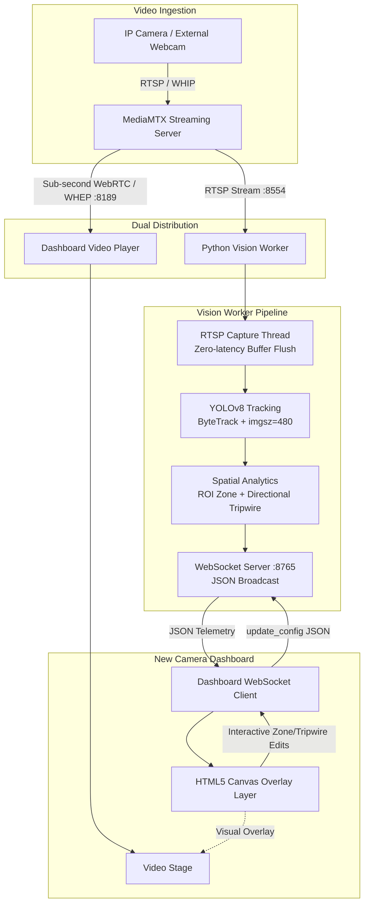

# Vision Worker (YOLOv8) Specification & Architecture Guide

This document defines the complete technical specifications, architectural concept, data contracts, and integration requirements for the **Vision AI YOLOv8 Worker**. Use this document as the reference blueprint to implement or replicate the real-time AI computer vision telemetry engine in any new camera dashboard project.

---

## 1. Architectural Concept & Philosophy

### 1.1 The Decoupled Telemetry Concept
Traditional computer vision streaming architectures often attempt to burn bounding boxes directly into the video stream (server-side overlay encoding with FFmpeg or OpenCV). This creates serious drawbacks:
* High CPU/GPU encoding overhead and latency.
* Degraded stream quality due to re-compression.
* Inability for client dashboards to interact with detections (cannot click boxes, cannot toggle overlays, cannot customize colors).
* Contaminated raw video archives (stored video contains permanent bounding boxes).

**The Solution:** The **Decoupled AI Overlay Architecture**.
1. **Video Transport Layer:** Video flows directly from the media server (MediaMTX, RTSP, or WebRTC gateway) to the frontend `<video>` player with ultra-low sub-second latency (WHEP / WebRTC).
2. **AI Telemetry Layer:** A lightweight standalone Python microservice (`vision_worker.py`) ingests the raw RTSP feed concurrently, executes YOLOv8 object detection and ByteTrack tracking, and emits pure JSON telemetry over a WebSocket connection (`ws://localhost:8765`).
3. **Client-Side Rendering Layer:** The frontend camera dashboard layers an HTML5 Canvas directly on top of the `<video>` player, dynamically projecting bounding boxes, motion trails, tripwires, and security zones onto the live video.



---

## 2. Core Capabilities & Technical Specifications

### 2.1 Zero-Latency RTSP Ingestion (`RTSPCaptureThread`)
OpenCV's standard `cv2.VideoCapture` buffers incoming network packets by default. Over time or under slight CPU delay, this buffer causes the AI inference to lag 3 to 10 seconds behind live video.

* **Requirement:** Dedicated background thread that continuously grabs and discards buffered frames, ensuring the inference loop always receives the newest frame.
* **FFmpeg Parameters:**
  ```python
  os.environ["OPENCV_FFMPEG_CAPTURE_OPTIONS"] = "rtsp_transport;udp|fflags;nobuffer|max_delay;0"
  ```
* **Capture Properties:**
  ```python
  cap = cv2.VideoCapture(rtsp_url, cv2.CAP_FFMPEG)
  cap.set(cv2.CAP_PROP_BUFFERSIZE, 1)
  ```
* **Thread Safety:** Use a `threading.Lock` when swapping and reading `latest_frame`.

---

### 2.2 YOLOv8 Object Detection & ByteTrack Multi-Object Tracking (MOT)
* **Model:** YOLOv8 Nano (`yolov8n.pt`) is recommended for real-time edge/CPU execution (~20–40ms per frame). For GPU-accelerated hardware, `yolov8s.pt` or `yolov8m.pt` can be substituted.
* **Tracking API:** Call `model.track()` instead of `model()`:
  ```python
  results = self.model.track(
      frame,
      imgsz=480,        # 480px balance between speed and detection range
      conf=0.35,        # Confidence threshold
      verbose=False,
      persist=True      # Essential: keeps track IDs persistent across consecutive frames
  )
  ```
* **Tracking IDs:** ByteTrack automatically assigns an integer `track_id` to each detected entity.
* **Stale Track Pruning:** Tracks not detected for more than 8.0 seconds are purged from internal memory to prevent memory leaks.

---

### 2.3 Normalized Coordinate System (0.0 to 1.0)
To ensure frontend responsiveness across any screen size, video resolution, or canvas scale, **all coordinates emitted by the worker must be normalized from 0.0 to 1.0**:

$$\text{norm}_x = \frac{x}{\text{width}}, \quad \text{norm}_y = \frac{y}{\text{height}}$$

* **Bounding Box Format:** `[x1, y1, x2, y2]` where:
  * `x1, y1`: Top-left corner (normalized $0.0 \dots 1.0$).
  * `x2, y2`: Bottom-right corner (normalized $0.0 \dots 1.0$).
* **Ground Contact Anchor (Foot Position):**
  For security zones and tripwires, using the center of the bounding box produces false positives (e.g., someone's head leaning over a line). Always use the **bottom-center point (feet)**:
  $$\text{foot}_x = \frac{\text{box}[0] + \text{box}[2]}{2.0}, \quad \text{foot}_y = \text{box}[3]$$

---

### 2.4 Spatial Security Analytics Engine

The worker implements two core spatial analytical primitives:

#### 1. Region of Interest (ROI) Door Zone
* **Format:** `[x1, y1, x2, y2]` in normalized coordinates (e.g., `[0.30, 0.20, 0.70, 0.85]`).
* **Algorithm:** Check if a person's foot contact point falls inside the rectangle:
  $$\min(x_1, x_2) \le \text{foot}_x \le \max(x_1, x_2) \quad \text{and} \quad \min(y_1, y_2) \le \text{foot}_y \le \max(y_1, y_2)$$
* **Event Trigger:** When a track transitions from outside the zone to inside the zone, emit a `"zone_breach"` event.

#### 2. Directional Tripwire Line Crossing
* **Format:** Line segment between two points $P_1(x_1, y_1)$ and $P_2(x_2, y_2)$ (e.g., `[[0.30, 0.65], [0.70, 0.65]]`).
* **Intersection Detection:** Determines if the movement vector from previous position $A$ to current position $B$ intersects the line segment $CD$ ($P_1 \to P_2$) using the Counter-Clockwise (CCW) segment intersection algorithm:
  $$\text{ccw}(A, B, C) = (C_y - A_y)(B_x - A_x) > (B_y - A_y)(C_x - A_x)$$
  $$\text{intersect} = (\text{ccw}(A, C, D) \neq \text{ccw}(B, C, D)) \land (\text{ccw}(A, B, C) \neq \text{ccw}(A, B, D))$$
* **Direction Determination (Cross Product Side Test):**
  $$\text{side}(P_1, P_2, \text{pt}) = (P_{2x} - P_{1x})(\text{pt}_y - P_{1y}) - (P_{2y} - P_{1y})(\text{pt}_x - P_{1x})$$
  * $\text{side}_{\text{prev}} < 0 \land \text{side}_{\text{curr}} \ge 0 \implies$ **ENTRY** (Increment `entry_count`).
  * $\text{side}_{\text{prev}} > 0 \land \text{side}_{\text{curr}} \le 0 \implies$ **EXIT** (Increment `exit_count`).
* **Debounce / Cooldown:** Minimum 2.0-second cooldown per `track_id` to prevent jitter or oscillation when a subject lingers on the line.

---

## 3. Communication Protocols & JSON Contracts

The worker runs a WebSocket server on `ws://0.0.0.0:8765`.

### 3.1 Server $\to$ Client Messages

#### A. Initial Connection Handshake (`system`)
Sent immediately when a dashboard client connects:
```json
{
  "type": "system",
  "status": "connected",
  "message": "Connected to TM Vision AI Telemetry Engine",
  "config": {
    "door_zone": [0.30, 0.20, 0.70, 0.85],
    "tripwire": [[0.30, 0.65], [0.70, 0.65]],
    "door_focus_only": false,
    "person_only": false,
    "entry_count": 14,
    "exit_count": 8,
    "events": [
      {
        "id": 1,
        "timestamp": "14:22:05",
        "type": "entry",
        "message": "ENTRY DETECTED: Person #3 entered through door",
        "track_id": 3,
        "label": "person",
        "confidence": 0.88
      }
    ]
  }
}
```

#### B. Real-Time Detection Telemetry (`ai_detection`)
Broadcast at high frequency (15–30+ FPS depending on hardware):
```json
{
  "type": "ai_detection",
  "timestamp": 1741423851.34,
  "inference_ms": 28.4,
  "fps": 26.5,
  "frame_size": [1280, 720],
  "counts": {
    "person": 2,
    "backpack": 1
  },
  "total_objects": 3,
  "detections": [
    {
      "box": [0.3452, 0.2184, 0.4512, 0.6841],
      "class_id": 0,
      "label": "person",
      "confidence": 0.89,
      "track_id": 4,
      "in_zone": true,
      "crossed": "entry",
      "trail": [
        [0.398, 0.72],
        [0.398, 0.70],
        [0.398, 0.684]
      ]
    }
  ],
  "security": {
    "door_zone": [0.30, 0.20, 0.70, 0.85],
    "tripwire": [[0.30, 0.65], [0.70, 0.65]],
    "door_focus_only": false,
    "person_only": false,
    "in_zone_count": 1,
    "entry_count": 15,
    "exit_count": 8,
    "status": "breached",
    "events": [
      {
        "id": 2,
        "timestamp": "14:23:10",
        "type": "zone_breach",
        "message": "Person #4 entered Door Zone",
        "track_id": 4,
        "label": "person",
        "confidence": 0.89
      }
    ]
  }
}
```

#### C. Stream Offline / Waiting Status (`ai_status`)
Emitted when RTSP stream is disconnected or reconnecting:
```json
{
  "type": "ai_status",
  "status": "waiting_for_stream",
  "rtsp_url": "rtsp://localhost:8554/lobby_camera",
  "fps": 0,
  "counts": {},
  "detections": [],
  "security": {
    "door_zone": [0.30, 0.20, 0.70, 0.85],
    "tripwire": [[0.30, 0.65], [0.70, 0.65]],
    "entry_count": 15,
    "exit_count": 8,
    "in_zone_count": 0,
    "events": []
  }
}
```

---

### 3.2 Client $\to$ Server Commands

#### A. Dynamic Zone & Tripwire Update (`update_config`)
Sent by the dashboard when the operator draws or adjusts zones:
```json
{
  "type": "update_config",
  "door_zone": [0.25, 0.15, 0.75, 0.90],
  "tripwire": [[0.25, 0.70], [0.75, 0.70]],
  "door_focus_only": false,
  "person_only": true
}
```

#### B. Reset Security Counters (`reset_counts`)
Sent when operator clicks "Reset Counts" on dashboard:
```json
{
  "type": "reset_counts"
}
```

---

## 4. Frontend Dashboard Integration Expectations

To achieve the exact visual and functional result in your new dashboard, implement the following frontend patterns:

### 4.1 DOM Layering (The Viewport Stage)
Stack a transparent HTML5 `<canvas>` directly over the `<video>` element with matching positions and CSS:
```html
<div class="video-container" style="position: relative; width: 100%; aspect-ratio: 16/9; overflow: hidden;">
    <!-- Sub-second WebRTC video feed -->
    <video id="camera-video" autoplay muted playsinline style="position: absolute; width: 100%; height: 100%; object-fit: contain;"></video>
    <!-- Overlay canvas for bounding boxes and zones -->
    <canvas id="ai-canvas" style="position: absolute; top: 0; left: 0; width: 100%; height: 100%; pointer-events: none; z-index: 10;"></canvas>
</div>
```
*(Note: When entering interactive drawing mode, set `pointer-events: auto` on the canvas).*

### 4.2 Letterbox & Pillarbox Aspect Ratio Compensation
Cameras and browser windows rarely match exact aspect ratios. When `object-fit: contain` is used, the video may be letterboxed (black bars top/bottom) or pillarboxed (black bars left/right).

The frontend mapping functions must calculate the exact active video rectangle on the canvas:
```javascript
function getRenderDimensions(frameSize) {
    const canvasW = canvas.width;
    const canvasH = canvas.height;
    let renderW = canvasW;
    let renderH = canvasH;
    let offsetX = 0;
    let offsetY = 0;

    if (frameSize && frameSize[0] > 0 && frameSize[1] > 0) {
        const frameAspect = frameSize[0] / frameSize[1];
        const canvasAspect = canvasW / canvasH;

        if (canvasAspect > frameAspect) {
            renderH = canvasH;
            renderW = canvasH * frameAspect;
            offsetX = (canvasW - renderW) / 2;
            offsetY = 0;
        } else {
            renderW = canvasW;
            renderH = canvasW / frameAspect;
            offsetX = 0;
            offsetY = (canvasH - renderH) / 2;
        }
    }
    return { canvasW, canvasH, renderW, renderH, offsetX, offsetY };
}

// Normalized (0.0 - 1.0) to Canvas Pixels
function normToCanvas(nx, ny, frameSize) {
    const { renderW, renderH, offsetX, offsetY } = getRenderDimensions(frameSize);
    return {
        x: offsetX + (nx * renderW),
        y: offsetY + (ny * renderH)
    };
}

// Canvas Pixels back to Normalized (0.0 - 1.0)
function canvasToNorm(cx, cy, frameSize) {
    const { renderW, renderH, offsetX, offsetY } = getRenderDimensions(frameSize);
    return {
        x: Math.max(0, Math.min(1, (cx - offsetX) / renderW)),
        y: Math.max(0, Math.min(1, (cy - offsetY) / renderH))
    };
}
```

### 4.3 Visual Styling Guidelines
* **Bounding Boxes:**
  * Thickness: 2.5px – 3.5px.
  * Glow: Neon drop-shadow (`ctx.shadowBlur = 8`, `ctx.shadowColor = color`).
  * Fill: 12% opacity fill tint.
  * Default color: Class-based (e.g., `#FF7A00` for person, `#00D2FF` for phone).
  * Breach color: `#EF4444` (bold crimson red) when `in_zone === true`.
* **Motion Trails:**
  * Polyline connecting the last 10 points in `det.trail`.
  * Foot tracking circle at terminal point ($r = 4\text{px}$).
* **Door Zone (ROI):**
  * Idle: Cyan outline (`#00B4D8`) with subtle corner bracket accents.
  * Breached: Flashing/Glowing Red (`#EF4444`), dashed border `[8, 5]`, and badge warning.
* **Directional Tripwire:**
  * Emerald green (`#10B981`) line with terminal dots.
  * Normal vector arrow pointing perpendicular to line showing entry flow direction.

---

## 5. Prerequisites & Dependencies

### 5.1 Python Environment
* Python 3.9, 3.10, or 3.11.
* Packages:
  ```bash
  pip install ultralytics opencv-python websockets
  ```

### 5.2 Model Weights
* Ensure `yolov8n.pt` is located in the working directory (or Ultralytics will auto-download it on first launch).

### 5.3 Streaming Source
* MediaMTX or RTSP camera exposing an H.264 video stream:
  `rtsp://localhost:8554/lobby_camera` (or your target camera path/IP).

---

## 6. Complete Python Reference Implementation (`vision_worker.py`)

Here is the complete, self-contained reference code for the vision worker:

```python
import asyncio
from collections import defaultdict, deque
import datetime
import json
import logging
import os
import sys
import threading
import time
import cv2
from ultralytics import YOLO
import websockets

# 1. Logging setup
logging.basicConfig(
    level=logging.INFO,
    format="%(asctime)s [%(levelname)s] %(message)s",
    datefmt="%H:%M:%S"
)
logger = logging.getLogger("VisionWorker")

# 2. Minimize OpenCV FFmpeg RTSP latency and buffering
os.environ["OPENCV_FFMPEG_CAPTURE_OPTIONS"] = "rtsp_transport;udp|fflags;nobuffer|max_delay;0"


# 3. Spatial Math Utilities
def ccw(A, B, C):
    """Counter-clockwise test for 3 points A, B, C."""
    return (C[1] - A[1]) * (B[0] - A[0]) > (B[1] - A[1]) * (C[0] - A[0])


def check_line_intersect(A, B, C, D):
    """Returns True if line segment AB intersects line segment CD."""
    return (ccw(A, C, D) != ccw(B, C, D)) and (ccw(A, B, C) != ccw(A, B, D))


def line_side(P1, P2, pt):
    """
    Returns signed value indicating which side of vector P1 -> P2 the point pt lies.
    Positive: Left side of vector
    Negative: Right side of vector
    """
    return (P2[0] - P1[0]) * (pt[1] - P1[1]) - (P2[1] - P1[1]) * (pt[0] - P1[0])


def point_in_zone(pt, zone):
    """Check if point pt (x, y) is inside normalized rectangular zone [x1, y1, x2, y2]."""
    if not zone or len(zone) < 4:
        return False
    x1, y1, x2, y2 = zone
    min_x, max_x = min(x1, x2), max(x1, x2)
    min_y, max_y = min(y1, y2), max(y1, y2)
    return min_x <= pt[0] <= max_x and min_y <= pt[1] <= max_y


# 4. Zero-Latency Threaded RTSP Capture
class RTSPCaptureThread:
    def __init__(self, rtsp_url):
        self.rtsp_url = rtsp_url
        self.latest_frame = None
        self.running = False
        self.lock = threading.Lock()
        self.thread = None
        self.is_connected = False

    def start(self):
        self.running = True
        self.thread = threading.Thread(target=self._update, daemon=True)
        self.thread.start()
        return self

    def _update(self):
        logger.info(f"Connecting background RTSP capture to: {self.rtsp_url}")
        cap = None
        while self.running:
            if cap is None or not cap.isOpened():
                cap = cv2.VideoCapture(self.rtsp_url, cv2.CAP_FFMPEG)
                cap.set(cv2.CAP_PROP_BUFFERSIZE, 1)
                if not cap.isOpened():
                    self.is_connected = False
                    time.sleep(1.5)
                    continue
                else:
                    self.is_connected = True
                    logger.info("RTSP stream connected successfully!")

            ret, frame = cap.read()
            if not ret:
                self.is_connected = False
                if cap is not None:
                    cap.release()
                cap = None
                time.sleep(1.0)
                continue

            with self.lock:
                self.latest_frame = frame
                self.is_connected = True

        if cap is not None:
            cap.release()

    def get_latest_frame(self):
        with self.lock:
            if self.latest_frame is not None:
                return self.latest_frame.copy(), self.is_connected
            return None, self.is_connected

    def stop(self):
        self.running = False
        if self.thread and self.thread.is_alive():
            self.thread.join(timeout=2.0)


# 5. Vision AI Telemetry Server
class VisionAIServer:
    def __init__(self, rtsp_url="rtsp://localhost:8554/lobby_camera", ws_port=8765, model_name="yolov8n.pt", imgsz=480):
        self.rtsp_url = rtsp_url
        self.ws_port = ws_port
        self.imgsz = imgsz
        self.connected_clients = set()
        self.clients_lock = threading.Lock()
        self.capture_thread = RTSPCaptureThread(self.rtsp_url)
        self.running = True

        # Normalized coordinates (0.0 - 1.0)
        self.door_zone = [0.30, 0.20, 0.70, 0.85]
        self.tripwire = [[0.30, 0.65], [0.70, 0.65]]
        self.door_focus_only = False
        self.person_only = False

        # Analytics State
        self.entry_count = 0
        self.exit_count = 0
        self.event_counter = 0
        self.recent_events = deque(maxlen=25)

        # Track histories
        self.track_history = defaultdict(lambda: deque(maxlen=20))
        self.track_last_seen = {}
        self.track_last_cross = {}
        self.track_zone_state = {}

        logger.info(f"Loading YOLO model: {model_name}...")
        self.model = YOLO(model_name)
        logger.info("YOLO model initialized with tracking capability.")

    def add_security_event(self, event_type, message, track_id=None, label="person", confidence=0.0):
        self.event_counter += 1
        now_str = datetime.datetime.now().strftime("%H:%M:%S")
        evt = {
            "id": self.event_counter,
            "timestamp": now_str,
            "type": event_type,
            "message": message,
            "track_id": track_id,
            "label": label,
            "confidence": round(confidence, 2)
        }
        self.recent_events.append(evt)
        logger.info(f"[SECURITY EVENT] {message}")
        return evt

    async def register_client(self, websocket):
        with self.clients_lock:
            self.connected_clients.add(websocket)
        logger.info(f"Dashboard client connected: {websocket.remote_address} (Active clients: {len(self.connected_clients)})")
        try:
            # Send initial sync payload
            await websocket.send(json.dumps({
                "type": "system",
                "status": "connected",
                "message": "Connected to TM Vision AI Telemetry Engine",
                "config": {
                    "door_zone": self.door_zone,
                    "tripwire": self.tripwire,
                    "door_focus_only": self.door_focus_only,
                    "person_only": self.person_only,
                    "entry_count": self.entry_count,
                    "exit_count": self.exit_count,
                    "events": list(self.recent_events)
                }
            }))

            async for message in websocket:
                try:
                    data = json.loads(message)
                    mtype = data.get("type")

                    if mtype == "update_config":
                        if "door_zone" in data:
                            self.door_zone = data["door_zone"]
                        if "tripwire" in data:
                            self.tripwire = data["tripwire"]
                        if "door_focus_only" in data:
                            self.door_focus_only = bool(data["door_focus_only"])
                        if "person_only" in data:
                            self.person_only = bool(data["person_only"])
                        logger.info(f"Updated security config: zone={self.door_zone}, tripwire={self.tripwire}")

                    elif mtype == "reset_counts":
                        self.entry_count = 0
                        self.exit_count = 0
                        self.recent_events.clear()
                        logger.info("Security counters and audit events reset by operator.")

                except Exception as parse_err:
                    logger.error(f"Error handling message from dashboard: {parse_err}")

        except websockets.exceptions.ConnectionClosed:
            pass
        finally:
            with self.clients_lock:
                self.connected_clients.discard(websocket)
            logger.info(f"Dashboard client disconnected (Remaining clients: {len(self.connected_clients)})")

    async def broadcast_detections(self, payload):
        with self.clients_lock:
            clients = list(self.connected_clients)

        if not clients:
            return

        message = json.dumps(payload)
        dead_clients = []
        for client in clients:
            try:
                await client.send(message)
            except Exception:
                dead_clients.append(client)

        if dead_clients:
            with self.clients_lock:
                for dead in dead_clients:
                    self.connected_clients.discard(dead)

    async def inference_loop(self):
        fps_counter = 0
        fps_start_time = time.time()
        current_fps = 0.0

        while self.running:
            try:
                frame, is_connected = self.capture_thread.get_latest_frame()

                if frame is None or not is_connected:
                    if self.connected_clients:
                        await self.broadcast_detections({
                            "type": "ai_status",
                            "status": "waiting_for_stream",
                            "rtsp_url": self.rtsp_url,
                            "fps": 0,
                            "counts": {},
                            "detections": [],
                            "security": {
                                "door_zone": self.door_zone,
                                "tripwire": self.tripwire,
                                "entry_count": self.entry_count,
                                "exit_count": self.exit_count,
                                "in_zone_count": 0,
                                "events": list(self.recent_events)
                            }
                        })
                    await asyncio.sleep(0.5)
                    continue

                t_start = time.perf_counter()
                height, width = frame.shape[:2]

                # Run YOLOv8 inference with ByteTrack enabled
                results = self.model.track(
                    frame,
                    imgsz=self.imgsz,
                    verbose=False,
                    conf=0.35,
                    persist=True
                )
                t_end = time.perf_counter()
                inference_ms = (t_end - t_start) * 1000.0

                fps_counter += 1
                now = time.time()
                if now - fps_start_time >= 1.0:
                    current_fps = fps_counter / (now - fps_start_time)
                    fps_counter = 0
                    fps_start_time = now

                detections = []
                counts = {}
                in_zone_count = 0
                now_ts = time.time()

                # Clean up tracks unseen for > 8 seconds
                stale_ids = [tid for tid, last_seen in self.track_last_seen.items() if now_ts - last_seen > 8.0]
                for tid in stale_ids:
                    self.track_history.pop(tid, None)
                    self.track_last_seen.pop(tid, None)
                    self.track_last_cross.pop(tid, None)
                    self.track_zone_state.pop(tid, None)

                if len(results) > 0 and results[0].boxes is not None:
                    boxes = results[0].boxes
                    for box in boxes:
                        xyxy = box.xyxy[0].tolist()
                        conf = float(box.conf[0].item())
                        cls_id = int(box.cls[0].item())
                        label = self.model.names.get(cls_id, f"cls_{cls_id}")

                        if self.person_only and label != "person":
                            continue

                        track_id = int(box.id[0].item()) if box.id is not None else None

                        # Normalized bounding box coordinates (0.0 - 1.0)
                        norm_box = [
                            round(xyxy[0] / width, 4),
                            round(xyxy[1] / height, 4),
                            round(xyxy[2] / width, 4),
                            round(xyxy[3] / height, 4),
                        ]

                        # Ground contact anchor (foot position)
                        foot_x = round((norm_box[0] + norm_box[2]) / 2.0, 4)
                        foot_y = round(norm_box[3], 4)
                        curr_point = (foot_x, foot_y)

                        # Check Door Zone
                        in_zone = point_in_zone(curr_point, self.door_zone)
                        if in_zone:
                            in_zone_count += 1

                        crossed_direction = None
                        trail = []

                        if track_id is not None:
                            self.track_last_seen[track_id] = now_ts
                            history = self.track_history[track_id]

                            # Zone breach transition check
                            prev_in_zone = self.track_zone_state.get(track_id, False)
                            if in_zone and not prev_in_zone:
                                self.add_security_event(
                                    "zone_breach",
                                    f"Person #{track_id} entered Door Zone",
                                    track_id=track_id,
                                    label=label,
                                    confidence=conf
                                )
                            self.track_zone_state[track_id] = in_zone

                            # Directional Tripwire crossing check
                            if len(history) >= 2 and self.tripwire and len(self.tripwire) == 2:
                                p1, p2 = self.tripwire[0], self.tripwire[1]
                                prev_point = history[-1]

                                if check_line_intersect(prev_point, curr_point, p1, p2):
                                    last_cross = self.track_last_cross.get(track_id, 0)
                                    # 2.0s cooldown per track ID
                                    if now_ts - last_cross > 2.0:
                                        side_prev = line_side(p1, p2, prev_point)
                                        side_curr = line_side(p1, p2, curr_point)

                                        if side_prev < 0 and side_curr >= 0:
                                            self.entry_count += 1
                                            crossed_direction = "entry"
                                            self.track_last_cross[track_id] = now_ts
                                            self.add_security_event(
                                                "entry",
                                                f"ENTRY DETECTED: Person #{track_id} entered through door",
                                                track_id=track_id,
                                                label=label,
                                                confidence=conf
                                            )
                                        elif side_prev > 0 and side_curr <= 0:
                                            self.exit_count += 1
                                            crossed_direction = "exit"
                                            self.track_last_cross[track_id] = now_ts
                                            self.add_security_event(
                                                "exit",
                                                f"EXIT DETECTED: Person #{track_id} exited through door",
                                                track_id=track_id,
                                                label=label,
                                                confidence=conf
                                            )

                            history.append(curr_point)
                            trail = list(history)[-10:]

                        if self.door_focus_only and not in_zone:
                            continue

                        detections.append({
                            "box": norm_box,
                            "class_id": cls_id,
                            "label": label,
                            "confidence": round(conf, 2),
                            "track_id": track_id,
                            "in_zone": in_zone,
                            "crossed": crossed_direction,
                            "trail": trail
                        })

                        counts[label] = counts.get(label, 0) + 1

                payload = {
                    "type": "ai_detection",
                    "timestamp": time.time(),
                    "inference_ms": round(inference_ms, 1),
                    "fps": round(current_fps, 1),
                    "frame_size": [width, height],
                    "counts": counts,
                    "total_objects": len(detections),
                    "detections": detections,
                    "security": {
                        "door_zone": self.door_zone,
                        "tripwire": self.tripwire,
                        "door_focus_only": self.door_focus_only,
                        "person_only": self.person_only,
                        "in_zone_count": in_zone_count,
                        "entry_count": self.entry_count,
                        "exit_count": self.exit_count,
                        "status": "breached" if in_zone_count > 0 else "secure",
                        "events": list(self.recent_events)[-10:]
                    }
                }

                await self.broadcast_detections(payload)
                await asyncio.sleep(0.002)

            except Exception as loop_err:
                logger.error(f"Inference loop error: {loop_err}")
                await asyncio.sleep(0.1)

    async def run(self):
        self.capture_thread.start()
        logger.info(f"Starting WebSocket server on ws://0.0.0.0:{self.ws_port}...")

        async with websockets.serve(self.register_client, "0.0.0.0", self.ws_port):
            logger.info("TM Vision AI Worker is active and broadcasting security telemetry!")
            await self.inference_loop()


def main():
    # Configure target RTSP stream and WebSocket listening port
    rtsp_url = os.environ.get("RTSP_URL", "rtsp://localhost:8554/lobby_camera")
    ws_port = int(os.environ.get("WS_PORT", 8765))

    server = VisionAIServer(rtsp_url=rtsp_url, ws_port=ws_port, imgsz=480)
    try:
        asyncio.run(server.run())
    except KeyboardInterrupt:
        logger.info("Stopping Vision AI Worker...")
        server.running = False
        server.capture_thread.stop()
        sys.exit(0)


if __name__ == "__main__":
    main()
```

---

## 7. Engineering Pitfalls & Golden Rules

1. **Never Hardcode Pixel Coordinates:**
   Always use normalized coordinates `[0.0, 1.0]` across both the worker and the dashboard. Different monitors, dashboard responsive layouts, and video aspect ratios will completely break pixel-based coordinates.
2. **Always Use `persist=True` in `model.track()`:**
   If `persist=True` is omitted, ByteTrack will reset tracking IDs on every single frame, causing ID jitter (`#1` $\to$ `#2` $\to$ `#3` for the same person) and breaking line-crossing analytics.
3. **Always Anchor on Feet for Zones & Tripwires:**
   Using the center of the bounding box causes early triggers when a person bends forward or waves their hands. The bottom-center of the box (`foot_x = (x1 + x2) / 2.0`, `foot_y = y2`) accurately anchors the person's physical floor position.
4. **Debounce Line Crossing:**
   When someone stops directly on the tripwire line, tracking bounding box jitter will toggle their position back and forth across the line. A minimum 2-second cooldown per `track_id` is essential.
5. **Decouple Capture from Inference:**
   Running `cap.read()` in the same thread as YOLO inference inevitably leads to RTSP buffer backlog and lag. The background capture thread (`RTSPCaptureThread`) is mandatory for real-time live performance.
6. **Graceful Handling of Stream Downtime:**
   When the RTSP camera goes offline, the capture thread must continuously attempt reconnection without crashing the WebSocket server or disconnecting connected dashboard clients.

